<!-- Every card on this page is drawn by scripts/profile.py and refreshed daily by GitHub Actions. -->

  

  

## Trainer profile

I'm a backend engineer from Ahmedabad. I build the software that restaurants, bakeries and shops run on every day: point-of-sale platforms, kitchen displays, live queues and the APIs behind them.

- **Production first.** My systems run on real counters, so I design for flaky networks, many devices at once and printers that misbehave.
- **Realtime by default.** Waiter, cashier and kitchen stay in sync, and transactional writes make sure nothing gets billed twice.
- **AI that can act.** I build MCP servers and sandboxed execution so AI assistants can safely work inside business tools.

## My party

  

  Also in the PC box 
  

## Pokédex: production work

Software running in real businesses. The source is private client code, so these entries tell the story instead.

  
  
  
  
  
  

## PC box: projects

<table>
  <tr>
    <td align="center" width="25%">
       
      <a href="https://github.com/Harsh15505/FarAway-Examination"><b>FortisExam</b></a> 
      Zero-trust, cryptographically accountable exam platform 
      <a href="https://far-away-examination.vercel.app">live&nbsp;↗</a>
    </td>
    <td align="center" width="25%">
       
      <a href="https://github.com/Harsh15505/C3E1xIngenious-7.0"><b>Urban Intelligence</b></a> 
      20+ FastAPI endpoints and 7-day ML forecasts for city data 
      <a href="https://c3-e1x-ingenious-7-0-y7f6.vercel.app">live&nbsp;↗</a>
    </td>
    <td align="center" width="25%">
       
      <a href="https://github.com/Harsh15505/KitchenManagementSystem-HizenAssignment"><b>Fernleaf Kitchen Ops</b></a> 
      Orders to stations to dispatch to billing. Next.js + NestJS 
      <a href="https://kitchen-management-hizen.vercel.app">live&nbsp;↗</a>
    </td>
    <td align="center" width="25%">
       
      <a href="https://github.com/Harsh15505/PharmacyPrototype"><b>Pharmacy Prototype</b></a> 
      Pharmacy ordering and inventory 
      <a href="https://pharmacy-prototype-self.vercel.app">live&nbsp;↗</a>
    </td>
  </tr>
  <tr>
    <td align="center" width="25%">
       
      <a href="https://github.com/Harsh15505/-3DUrbanAssests"><b>3D Urban Assets</b></a> 
      Street photos to a semantic 3D map of poles, signs and lights 
      research
    </td>
    <td align="center" width="25%">
       
      <a href="https://github.com/Harsh15505/mini-project-encrypted-messenger"><b>Encrypted Messenger</b></a> 
      Diffie–Hellman key exchange and end-to-end encrypted chat 
      code
    </td>
    <td align="center" width="25%">
       
      <a href="https://github.com/Harsh15505/landmannalaugar-terrain-renderer"><b>Terrain Renderer</b></a> 
      Real-time 3D terrain of Iceland with live satellite and weather 
      code
    </td>
    <td align="center" width="25%">
       
      <a href="https://github.com/Harsh15505/ReBAC-Implementation"><b>ReBAC</b></a> 
      Relationship-based access control in NestJS 
      code
    </td>
  </tr>
</table>

## Research

  

## Base stats

  

  

## A wild Pokémon appeared!

  

  
   
  One throw per trainer per day · a new Pokémon appears at 00:00 IST · your catch joins the Visitor Dex

 

  <a href="https://www.linkedin.com/in/harsh-bhavsar-6559b62a8">LinkedIn</a>
    
  Sprites from <a href="https://github.com/PokeAPI/sprites">PokeAPI</a>. Pokémon © Nintendo, Game Freak and The Pokémon Company. Fan-made and non-commercial.

