<!-- ✿ hi, curious one! the stats cards below are regenerated daily by .github/workflows/stats.yml ✿ -->

<p align="center">
  
</p>

<p align="center">
  <a href="https://github.com/Harsh15505">
    
  </a>
</p>

<p align="center">
  <a href="https://www.linkedin.com/in/harsh-bhavsar-6559b62a8"></a>
  
  
</p>

---

### 🌷 about me

```ts
const harsh = {
  studying:   "B.Tech Computer Engineering @ PDEU (2023 – 2027) · CGPA 9.33",
  interned:   "Backend Developer @ Chaintech Network (Apr – Aug 2026)",
  loves:      ["backends that don't fall over", "real-time systems", "thermal printers 🖨️"],
  stack:      ["TypeScript", "Node.js", "Next.js", "PostgreSQL", "Supabase", "Python"],
  published:  "IEEE · Explainable ML for air pollution & child respiratory health",
  offline:    ["sketching ✏️", "chai ☕", "speaking 4 languages (EN · HI · GU · MR)"],
};
```

---

### 🍰 things I've shipped that real people use

> most of my best work lives in private client repos 🔒, so here's the story instead of the source!

<table>
<tr>
<td width="50%" valign="top">

#### 🍛 Chaska POS
Hybrid Android POS working in **6 Chaska branches across Ahmedabad**, plus a master reports dashboard for the owners.
- concurrency-safe multi-device ordering (Firestore transactions, zero duplicate KOTs)
- native **Bluetooth ESC/POS printing** via a custom Capacitor plugin
- self-hosted OTA updates + dynamic UPI QR billing
- **25,000+ bills placed · ₹50 lakh+ revenue processed** since launch

`Next.js` `TypeScript` `Capacitor` `Firebase` · 🔒 client · [demo ↗](https://ordering-billing-prototype.vercel.app/)

</td>
<td width="50%" valign="top">

#### 🥐 Mangleshwar Bakery POS
Cloud POS + franchise ordering platform for a bakery with multiple branches.
- PostgreSQL with role-based access & branch-wise data isolation
- real-time inventory, **Kitchen Display System**, production planning
- async receipt printing + a WhatsApp notification server
- owner dashboards for branch performance

`Next.js` `Supabase` `PostgreSQL` `Baileys` · 🔒 client · [staging ↗](https://mangleshwar-puff-pos-staging.vercel.app/orders/)

</td>
</tr>
<tr>
<td width="50%" valign="top">

#### 🤖 Enterprise MCP servers · Chaintech
3 production **Model Context Protocol** servers so AI assistants can safely work inside business tools.
- **236 tools**: HubSpot (112) · Zoho CRM (70) · Shopify (54)
- OAuth 2.0 + REST integrations
- sandboxed skill execution with **Docker + gVisor**, Redis & BullMQ queues

`TypeScript` `Node.js` `MCP SDK` `Docker` `Redis` · 🏢 company code

</td>
<td width="50%" valign="top">

#### ⏳ Ketli Vaar? <sub>(કેટલી વાર?)</sub>
"How long?" — a real-time restaurant waitlist. Customers join by scanning a QR, staff run the queue from a live dashboard, everyone gets pinged on WhatsApp.
- Supabase Realtime for instant queue updates
- multi-restaurant admin with full user management

`Next.js 16` `Supabase` `Tailwind` `shadcn/ui` · 🔒 private

</td>
</tr>
<tr>
<td width="50%" valign="top">

#### 🔥 Shahi Sigdi · offline LAN POS
A restaurant POS that works with **no internet at all**: waiter, kitchen and billing screens talk over the local network.

`Next.js` `Express` `Socket.io` `SQLite` `Electron` · 🔒 client

</td>
<td width="50%" valign="top">

#### 🛒 Priti Sales · retail app
Android retail-sales management app for a distributor, with over-the-air updates.

`React` `Capacitor` `Supabase` · 🔒 client

<sub>✨ + POS builds for Idly King, Danny's Coffee Bar & Bhagod</sub>

</td>
</tr>
</table>

---

### 🧪 open projects you can poke at

| | project | what it does | try it |
|:-:|---|---|:-:|
| 🛡️ | [**FortisExam**](https://github.com/Harsh15505/FarAway-Examination) | zero-trust, cryptographically accountable exam infrastructure | [live ↗](https://far-away-examination.vercel.app) |
| 🏙️ | [**Urban Intelligence & Forecasting**](https://github.com/Harsh15505/C3E1xIngenious-7.0) | 20+ FastAPI endpoints + 7-day ML forecasts for city data (team of 4) | [live ↗](https://c3-e1x-ingenious-7-0-y7f6.vercel.app) |
| 🍱 | [**Fernleaf Kitchen Ops**](https://github.com/Harsh15505/KitchenManagementSystem-HizenAssignment) | orders → kitchen stations → dispatch → billing, for a boxed-meal kitchen | [live ↗](https://kitchen-management-hizen.vercel.app) |
| 🗺️ | [**3D Urban Assets**](https://github.com/Harsh15505/-3DUrbanAssests) | street photos (KITTI-360) → semantic 3D map of poles, signs & lights | research |
| 💊 | [**Pharmacy Prototype**](https://github.com/Harsh15505/PharmacyPrototype) | pharmacy ordering & inventory prototype | [live ↗](https://pharmacy-prototype-self.vercel.app) |
| 🔐 | [**Encrypted Messenger**](https://github.com/Harsh15505/mini-project-encrypted-messenger) | Diffie–Hellman key exchange + end-to-end encrypted chat | code |
| 🏔️ | [**Landmannalaugar Renderer**](https://github.com/Harsh15505/landmannalaugar-terrain-renderer) | real-time 3D terrain of Iceland with live satellite & weather | code |
| 🔑 | [**ReBAC Implementation**](https://github.com/Harsh15505/ReBAC-Implementation) | relationship-based access control in NestJS | code |

---

### 📄 research

**Evaluating the Association Between Ambient Air Pollution and Pediatric Respiratory Admissions Using Explainable Machine Learning** — *IEEE ICE2NT 2026 (accepted)*
<br/>XGBoost + SHAP on 1,110 real patient records from Ahmedabad joined with OpenAQ air-quality data · AUC-ROC **0.775**

---

### 🧸 my toy box

<p align="center">
  
</p>

---

### 🌱 my little garden of stats

<p align="center">
  
  
</p>

<p align="center">
  <picture>
    <source media="(prefers-color-scheme: dark)" srcset="https://raw.githubusercontent.com/Harsh15505/Harsh15505/output/snake-dark.svg" />
    
  </picture>
</p>

---

### 🍡 little things about me

- 🎯 qualified **JEE Advanced 2023**
- 🧠 **Elite + Top 5%** (90/100) in NPTEL Deep Learning, IIT Ropar
- 🖨️ I've debugged more thermal printers than I'd like to admit
- ✏️ I sketch, the pencil kind, not the Figma kind
- 🗣️ fluent in English, Hindi, Gujarati, Marathi... and TypeScript

<p align="center">
  <b>💌 building something for a restaurant, a shop, or an AI agent? let's talk!</b>
  <br/><br/>
  <a href="https://www.linkedin.com/in/harsh-bhavsar-6559b62a8"></a>
</p>

<p align="center">thanks for stopping by (｡•ᴗ•｡)♡</p>


